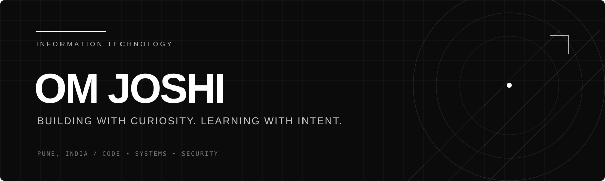
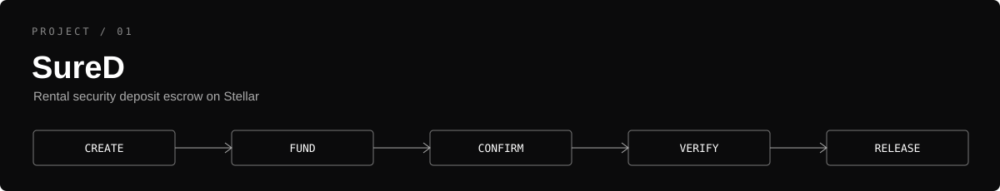
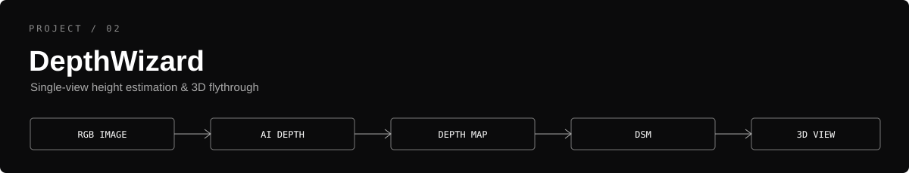
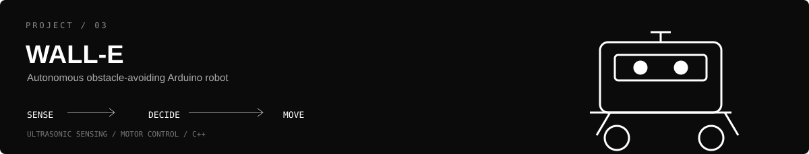
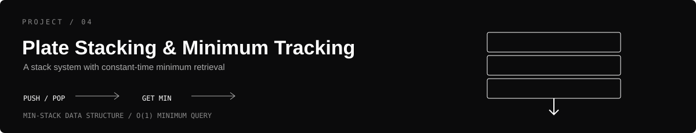
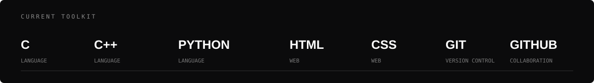
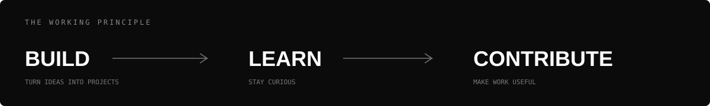

<!--
  OM JOSHI — GitHub Profile
  Visual system: Monochrome Editorial
-->

  

  <strong>INFORMATION TECHNOLOGY STUDENT</strong>
   
  Developer · Cybersecurity Enthusiast · Lifelong Learner

  <a href="https://github.com/omjoshi-2307">GITHUB</a>
  &nbsp; / &nbsp;
  <a href="https://www.linkedin.com/in/0m-joshi2307">LINKEDIN</a>
  &nbsp; / &nbsp;
  <a href="https://x.com/omjoshi_2307">X</a>
  &nbsp; / &nbsp;
  <a href="mailto:omjoshi2307@gmail.com">EMAIL</a>

  

## 01 / About Me

I'm an Information Technology student at **NMIET, Pune**, interested in how software, systems, and security come together.

I enjoy turning concepts into practical projects, understanding the logic behind the tools I use, and learning by building. My current interests include **programming fundamentals, web technologies, and cybersecurity**.

- Based in Pune, India
- Focused on strengthening core computer science and development skills
- Interested in cybersecurity, problem-solving, and collaborative projects

  

## 02 / What I'm Exploring

| Area | Current focus |
| --- | --- |
| Cybersecurity | Building a stronger foundation in security concepts and systems |
| Development | Improving programming, web development, and project-building skills |
| SureD 2.0 | Planning a multi-tenant experience for shared rental deposits; UI and flow decisions are being explored |
| CivicLoop | Planning a civic-complaint platform concept selected for Anveshana 2026–27 |

  

## 03 / Featured Projects

### SureD — Rental Security Deposit Platform

  

A blockchain-based rental security deposit platform built around a transparent escrow workflow. It uses **Stellar and Soroban** to support the deposit lifecycle, from funding to confirmation and release.

**Exploring next:** SureD 2.0 planning focuses on co-tenants, shared contributions, and clearer individual tracking. These are planned improvements, not shipped features.

[Live project](https://sure-d.vercel.app/) · [Source repository](https://github.com/Khushal-93/SureD)

### DepthWizard — Single-View Height Estimation

  

A web-app concept for **SIH 2026 problem statement PS26175**, focused on estimating scene height from a single image and generating a 3D flythrough.

The proposed pipeline moves from an RGB image to AI depth estimation, a depth map, a digital surface model (DSM), and a 3D view. Georeferenced inputs can support metric-scale outputs; ordinary images produce relative depth/height estimates.

### CivicLoop — Complaints That Don't Disappear

A civic-tech concept selected for **Anveshana 2026–27**. The idea is to make public complaints easier to track through a clear status history and evidence-based updates.

**Stage:** planning. Features and implementation details are still being shaped.

### WALL-E — Autonomous Robot

  

An Arduino-based obstacle-avoiding robot project using **C++**, ultrasonic sensing, and motor control to respond to its surroundings.

### Plate Stacking & Minimum Tracking System

  

A Python-based stack application that tracks the minimum element efficiently. Its min-stack approach supports **O(1) minimum retrieval**, alongside standard stack operations.

  

## 04 / Technical Skills

  

**Languages:** C, C++, Python  
**Web:** HTML, CSS  
**Tools:** Git, GitHub, VS Code

I'm continuously expanding this toolkit through coursework, experimentation, and project work.

  

## 05 / Achievements & Recognition

- **Anveshana 2026–27:** CivicLoop selected for the Pune Region programme.

  

## 06 / GitHub Activity

I use GitHub to document learning, build projects, collaborate, and improve through consistent practice.

  

  

  

## 07 / Beyond Coding

Curiosity doesn't stop at the editor. I enjoy exploring new technologies, understanding how things work, learning from other builders, and collaborating on ideas that can become useful products.

  

## 08 / Let's Connect

I'm always glad to connect with fellow students, developers, and people who enjoy learning and building.

  <a href="https://www.linkedin.com/in/0m-joshi2307">LinkedIn</a>
  &nbsp; · &nbsp;
  <a href="https://x.com/omjoshi_2307">X</a>
  &nbsp; · &nbsp;
  <a href="https://www.instagram.com/0m.a.joshi/">Instagram</a>
  &nbsp; · &nbsp;
  <a href="https://www.credly.com/users/om-joshi2623">Credly</a>
  &nbsp; · &nbsp;
  <a href="mailto:omjoshi2307@gmail.com">Email</a>

  

  BUILD WITH CURIOSITY · STAY GROUNDED · KEEP LEARNING

