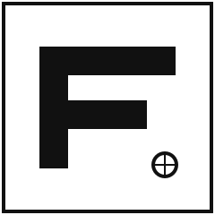
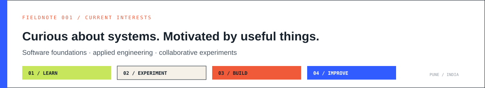
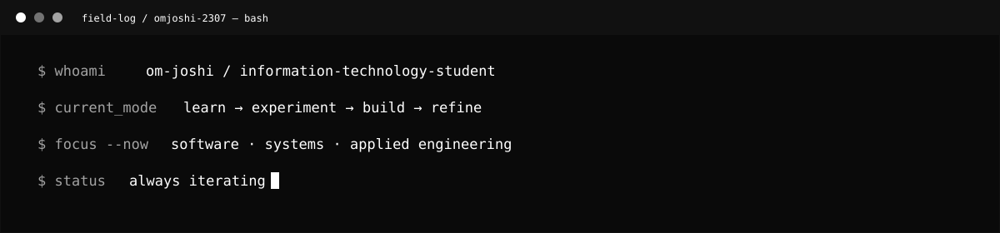
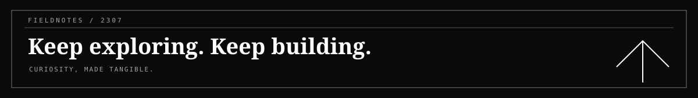

<picture>
  <source media="(prefers-color-scheme: dark)" srcset="./assets/branding/fieldnotes-header-dark.svg" />
  
</picture>

  <picture>
    <source media="(prefers-color-scheme: dark)" srcset="https://readme-typing-svg.demolab.com?font=JetBrains+Mono&size=17&pause=1100&color=FFFFFF&center=true&vCenter=true&width=760&lines=Information+Technology+Student;Exploring+software+and+systems;Learning+by+building+and+refining" />
    
  </picture>

  <a href="https://github.com/omjoshi-2307">GITHUB</a> &nbsp; / &nbsp;
  <a href="https://www.linkedin.com/in/0m-joshi2307">LINKEDIN</a> &nbsp; / &nbsp;
  <a href="https://x.com/omjoshi_2307">X</a> &nbsp; / &nbsp;
  <a href="mailto:omjoshi2307@gmail.com">EMAIL</a>
   
  

## About

I'm **Om Joshi**, an Information Technology student at **NMIET, Pune**. I enjoy understanding how systems work and turning ideas into practical experiments. My learning process is hands-on: explore a problem, build a thoughtful solution, test it, document what I learn, and keep refining.

- Interested in software development, computer systems, and applied engineering.
- Learning through coursework, independent builds, and collaborative projects.
- Focused on strong fundamentals, useful solutions, and maintainable work.

## Technical toolkit

  
  
  
  
  
  
  
  

Current working toolkit — a snapshot of foundations I'm actively developing.

## Selected work

<table>
<tr>
<td width="50%" valign="top">

### 01 / SureD
**Blockchain-based rental security deposit platform**

Explores a more transparent rental deposit lifecycle using the **Stellar network and Soroban smart contracts**: creation, funding, confirmation, and release or refund.

**In exploration:** SureD 2.0 planning considers co-tenants, shared contributions, and individual tracking. These are planned improvements, not shipped features.

<picture>
  <source media="(prefers-color-scheme: dark)" srcset="https://github-readme-stats.vercel.app/api/pin/?username=Khushal-93&repo=SureD&hide_border=true&bg_color=0A0A0A&title_color=FFFFFF&text_color=A3A3A3&icon_color=FFFFFF" />
  
</picture>

[Live platform](https://sure-d.vercel.app/) · [Source repository](https://github.com/Khushal-93/SureD)

</td>
<td width="50%" valign="top">

### 02 / DepthWizard
**Single-view height estimation and 3D flythrough**

A team project concept for **Smart India Hackathon 2026, SIH26175 / PS26175**. Proposed pipeline: RGB image → AI depth estimation → depth map → digital surface model → 3D flythrough.

Non-georeferenced images produce relative estimates; georeferenced inputs can support metric DSM outputs.

</td>
</tr>
<tr>
<td width="50%" valign="top">

### 03 / CivicLoop
**Complaints That Don't Disappear**

A civic-technology concept selected for **Anveshana 2026–27 (Pune Region)**.

**Stage:** concept and planning; development has not started. Reporting, duplicate clustering, public timelines, and ward insights remain proposed features.

</td>
<td width="50%" valign="top">

### 04 / WALL-E
**Autonomous obstacle-avoiding robot**

An Arduino-based robotics project using **C++, ultrasonic distance sensing, and motor control** to detect obstacles and respond through autonomous movement.

</td>
</tr>
</table>

## Workbench

  
<strong>How I approach a build</strong>

  1. Understand the problem and constraints before choosing a solution.
  2. Study references and test small ideas.
  3. Build in manageable, reviewable steps.
  4. Verify behavior and document important decisions.
  5. Refine based on evidence rather than assumptions.

  
<strong>Current areas of exploration</strong>

  - Programming fundamentals and problem-solving.
  - Software development and computer systems.
  - Computer vision and applied AI concepts.
  - Blockchain workflows and smart-contract applications.
  - Embedded systems and robotics.

## GitHub telemetry

  <picture>
    <source media="(prefers-color-scheme: dark)" srcset="https://github-readme-stats.vercel.app/api?username=omjoshi-2307&show_icons=true&hide_border=true&include_all_commits=true&rank_icon=github&theme=github_dark" />
    
  </picture>
  <picture>
    <source media="(prefers-color-scheme: dark)" srcset="https://github-readme-stats.vercel.app/api/top-langs/?username=omjoshi-2307&layout=compact&hide_border=true&langs_count=6&theme=github_dark" />
    
  </picture>

  <picture>
    <source media="(prefers-color-scheme: dark)" srcset="https://streak-stats.demolab.com?user=omjoshi-2307&hide_border=true&theme=github-dark-blue" />
    
  </picture>

  <picture>
    <source media="(prefers-color-scheme: dark)" srcset="https://github-profile-summary-cards.vercel.app/api/cards/profile-details?username=omjoshi-2307&theme=github_dark" />
    
  </picture>

### Contribution activity

  <picture>
    <source media="(prefers-color-scheme: dark)" srcset="https://raw.githubusercontent.com/omjoshi-2307/omjoshi-2307/output/github-contribution-grid-snake-dark.svg" />
    
  </picture>

### Achievements on GitHub

  <picture>
    <source media="(prefers-color-scheme: dark)" srcset="https://github-profile-trophy.vercel.app/?username=omjoshi-2307&theme=darkhub&no-frame=true&no-bg=true&margin-w=8&row=1" />
    
  </picture>

  <picture>
    <source media="(prefers-color-scheme: dark)" srcset="https://github-readme-activity-graph.vercel.app/graph?username=omjoshi-2307&bg_color=0A0A0A&color=FFFFFF&line=A3A3A3&point=FFFFFF&area=true&hide_border=true" />
    
  </picture>

## Connect

  <a href="https://github.com/omjoshi-2307">GitHub</a> &nbsp;·&nbsp;
  <a href="https://www.linkedin.com/in/0m-joshi2307">LinkedIn</a> &nbsp;·&nbsp;
  <a href="https://x.com/omjoshi_2307">X</a> &nbsp;·&nbsp;
  <a href="https://www.instagram.com/0m.a.joshi/">Instagram</a> &nbsp;·&nbsp;
  <a href="https://www.credly.com/users/om-joshi2623">Credly</a> &nbsp;·&nbsp;
  <a href="mailto:omjoshi2307@gmail.com">Email</a>

OM JOSHI · INFORMATION TECHNOLOGY · PUNE, INDIA

