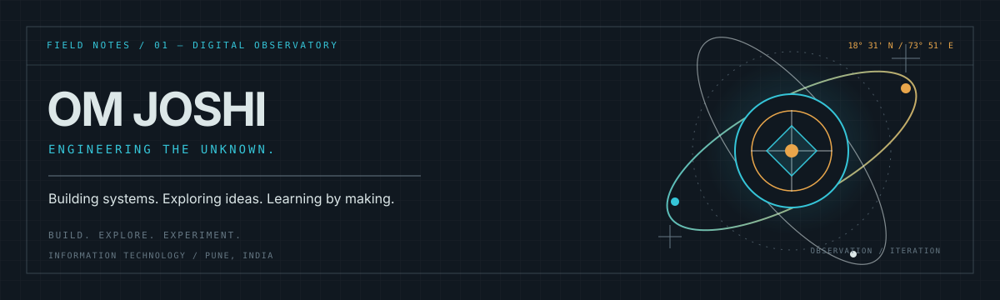
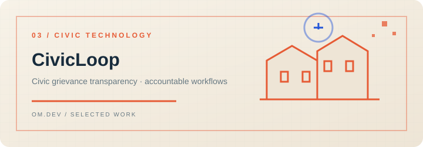
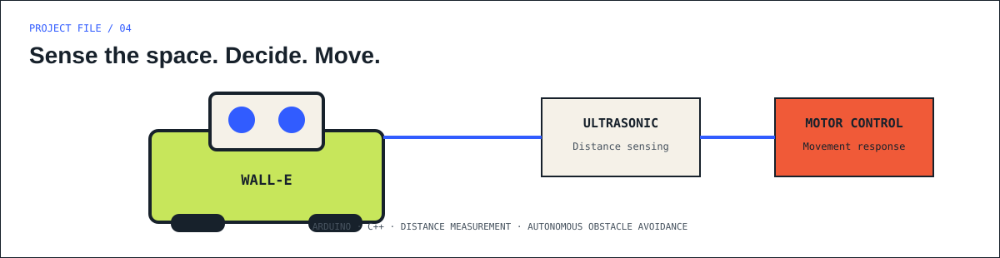
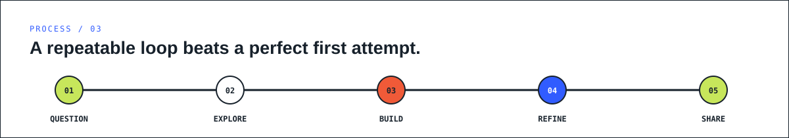

  

  <a href="#-about-the-builder">ABOUT</a> &nbsp;·&nbsp;
  <a href="#-technology-stack">TOOLKIT</a> &nbsp;·&nbsp;
  <a href="#-selected-work">PROJECTS</a> &nbsp;·&nbsp;
  <a href="#-github-activity">ACTIVITY</a> &nbsp;·&nbsp;
  <a href="#-connect">CONNECT</a>

  

<h2 align="center">ENGINEERING THE UNKNOWN.</h2>

<strong>BUILD. &nbsp; EXPLORE. &nbsp; EXPERIMENT.</strong>

  

## 🧭 About the Builder

I'm **Om Joshi**, an Information Technology student at **NMIET, Pune, India**. I like understanding how systems work, exploring ideas across software and engineering, and turning what I learn into practical experiments.

I approach development as a loop: **question → research → prototype → test → improve**. I value clear thinking, useful documentation, thoughtful interfaces, and projects that solve a real problem.

- 🎓 Information Technology student
- 🧩 Interested in software, computer systems, problem-solving, and applied engineering
- 🛠️ Learning through coursework, independent builds, and team projects
- 🌱 Focused on strengthening fundamentals and shipping useful work

## 🧰 Technology Stack

  

  
  
  
  
  
  
  
  

These are the tools and foundations I currently work with; the list reflects active learning, not a claim of expert-level proficiency.

## 🚀 Selected Work

A selection of projects across blockchain, computer vision, civic technology, and embedded systems.

<table>
  <tr>
    <td width="50%" valign="top">
      <h3>01 / SureD</h3>
      
<strong>Blockchain-backed rental deposit escrow</strong>

      
      
A rental security-deposit platform exploring transparent deposit creation, funding, confirmation, and release or refund using the <strong>Stellar network and Soroban smart contracts</strong>.

      
<strong>Exploring next:</strong> SureD 2.0 planning includes co-tenants, shared contributions, and individual tracking. These capabilities are planned, not shipped.

      
<a href="https://sure-d.vercel.app/">Live platform</a> · <a href="https://github.com/Khushal-93/SureD">Source repository</a>

    </td>
    <td width="50%" valign="top">
      <h3>02 / DepthWizard</h3>
      
<strong>Single-view height estimation &amp; 3D flythrough</strong>

      
      
A team project concept prepared for <strong>Smart India Hackathon 2026, SIH26175 / PS26175</strong>. The proposed web app explores estimating scene height from one image and generating a 3D flythrough.

      
<strong>Pipeline:</strong> RGB → AI depth → depth map → digital surface model → 3D view. Non-georeferenced inputs yield relative estimates; georeferenced inputs can support metric DSM outputs.

    </td>
  </tr>
  <tr>
    <td width="50%" valign="top">
      <h3>03 / CivicLoop</h3>
      
<strong>Complaints That Don't Disappear</strong>

      
      
A civic-technology concept selected for <strong>Anveshana 2026–27 (Pune Region)</strong>. The idea is to make public complaints easier to track through transparent histories and evidence-based updates.

      
<strong>Current stage:</strong> concept and planning; development has not started. Citizen reporting, duplicate clustering, public timelines, and ward insights are proposed features.

    </td>
    <td width="50%" valign="top">
      <h3>04 / WALL-E</h3>
      
<strong>Autonomous obstacle-avoiding robot</strong>

      
      
An Arduino-based robotics project using <strong>C++, ultrasonic distance sensing, and motor control</strong> to detect obstacles and respond through autonomous movement.

      
<strong>Core loop:</strong> sense the surroundings → decide a response → control movement.

    </td>
  </tr>
</table>

## 📡 GitHub Activity

I use GitHub as a working lab: documenting experiments, improving projects, collaborating, and learning in public.

  
  

  

### Contribution trail

  

  

## 🤝 Connect

I'm always glad to connect with fellow learners, developers, and people who enjoy building useful things.

  
  
  
  

  

THE DIGITAL OBSERVATORY · OM JOSHI · PUNE, INDIA

