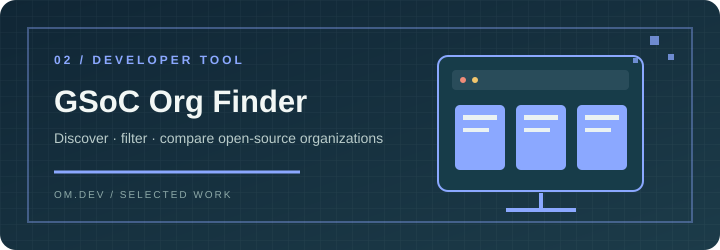
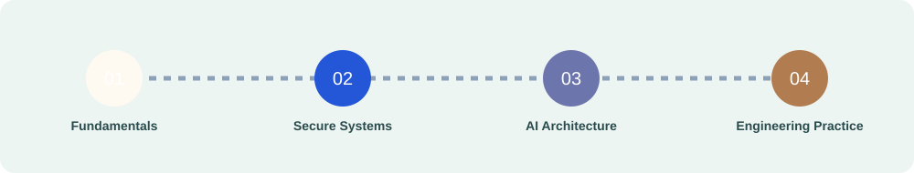
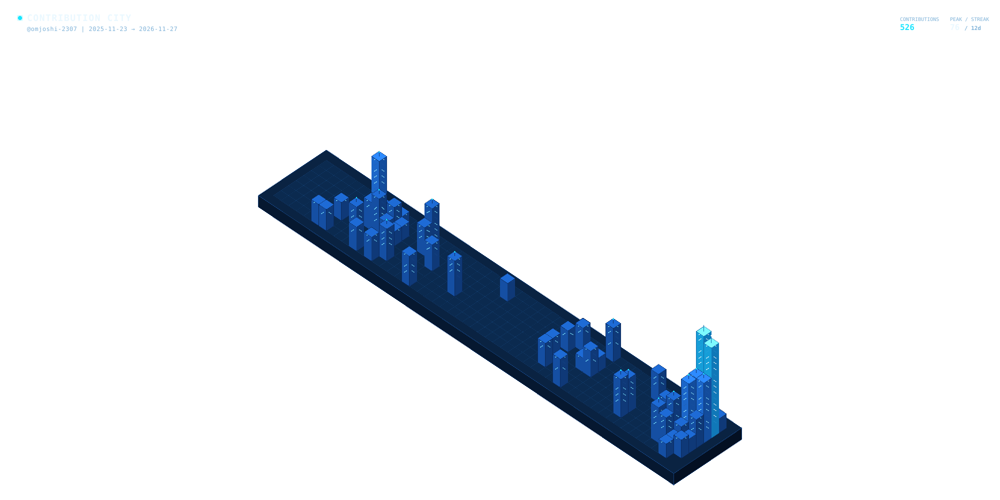
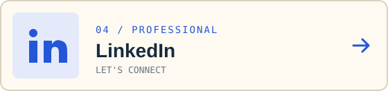

<!-- OM.DEV | FIELD NOTES — Warm Paper / Cobalt Edition -->

  

<h1 align="center">OM ARUN JOSHI</h1>

  <strong>INFORMATION TECHNOLOGY · SOFTWARE · SYSTEMS</strong> 
  <em>Driven by questions, guided by reason.</em>

---

## 01 — PROFILE

I'm pursuing a B.Tech in Information Technology at NMIET, Pune. I'm interested in how software and digital systems work beneath the surface, and I enjoy learning by building, exploring unfamiliar technologies, and turning ideas into practical experiments.

My current areas of curiosity include software engineering, cybersecurity, blockchain, artificial intelligence, and computer vision. I value strong fundamentals, clear reasoning, and thoughtful implementation over chasing tools for their own sake.

  

---

## 02 — TOOLKIT

**Languages**

  

**Frameworks, platforms & workflow**

  

Tools shown here are technologies I've used or explored; this is not a claim of equal proficiency across the stack.

---

## 03 — SELECTED WORK

A few projects and explorations across different problem spaces. Project descriptions reflect their current stage, not just the idea behind them.

<table>
  <tr>
    <td width="50%" valign="top">
      
      <h3><a href="https://github.com/Khushal-93/SureD">01 / SureD</a></h3>
      BLOCKCHAIN · RENTAL DEPOSITS
      
A blockchain-based rental security deposit platform focused on transparent escrow, deposit handling, and multi-party coordination.

      <a href="https://sure-d.vercel.app/">VIEW LIVE PROJECT ↗</a>
    </td>
    <td width="50%" valign="top">
      
      <h3><a href="https://github.com/omjoshi-2307/GSoC-Org-Finder-">02 / GSoC Org Finder</a></h3>
      DEVELOPER TOOLS · OPEN SOURCE
      
A platform for discovering, filtering, and comparing Google Summer of Code organizations, with organization details and GitHub issue discovery.

      <a href="https://findmygsoc.vercel.app/">OPEN PLATFORM ↗</a>
    </td>
  </tr>
  <tr>
    <td width="50%" valign="top">
      
      <h3><a href="https://github.com/omjoshi-2307/CivicLoop">03 / CivicLoop</a></h3>
      CIVIC TECHNOLOGY · ANVESHANA 2026–27
      
<i>Complaints That Don't Disappear.</i> A selected project proposal for transparent civic complaint tracking and accountable resolution. Development has not started.

    </td>
    <td width="50%" valign="top">
      
      <h3><a href="https://github.com/omjoshi-2307/jal-sanchaee-navachar-v2">04 / Jal-Sanchaee-Navachar</a></h3>
      SMART IRRIGATION · WATER MANAGEMENT
      
A water-conservation project exploring irrigation planning and community water credits through rule-based decisions and weather-informed inputs. Multiple repositories represent iterations of the same project.

    </td>
  </tr>
  <tr>
    <td width="50%" valign="top">
      
      <h3><a href="https://github.com/omjoshi-2307/Dev">05 / DEV</a></h3>
      HYBRID AI · ASSISTANT ARCHITECTURE
      
An early-stage exploration of a personal AI assistant architecture, including local and cloud model integration, model routing, and privacy-aware execution.

    </td>
    <td width="50%" valign="top">
      
      <h3>06 / DepthWizard</h3>
      COMPUTER VISION · SIH26175 CONCEPT
      
A proposed single-view height-estimation and 3D flythrough pipeline: RGB image → depth estimation → depth map → digital surface model → 3D visualization.

    </td>
  </tr>
</table>

---

## 04 — CURRENT CHAPTER

  

Strengthening computer science fundamentals, exploring cybersecurity and secure software design, learning more about AI systems, and improving architecture and engineering workflows.

---

## 05 — ACTIVITY LOG

  

  

  

  

---

## 06 — FIND ME ELSEWHERE

  HAVE A PROJECT IN MIND? WANT TO EXCHANGE IDEAS? 
  <strong>Choose your preferred channel.</strong>

<table>
  <tr>
    <td width="50%" align="center">
      
    </td>
    <td width="50%" align="center">
      
    </td>
  </tr>
  <tr>
    <td width="50%" align="center">
      
    </td>
    <td width="50%" align="center">
      
    </td>
  </tr>
  <tr>
    <td colspan="2" align="center">
      
    </td>
  </tr>
</table>

  📍 PUNE, INDIA &nbsp;·&nbsp; OPEN TO TECHNICAL CONVERSATIONS

  <strong>THANK YOU FOR STOPPING BY.</strong> 
  LEARN WITH INTENT · BUILD WITH PURPOSE · KEEP ITERATING

