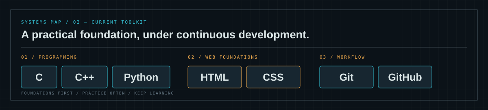
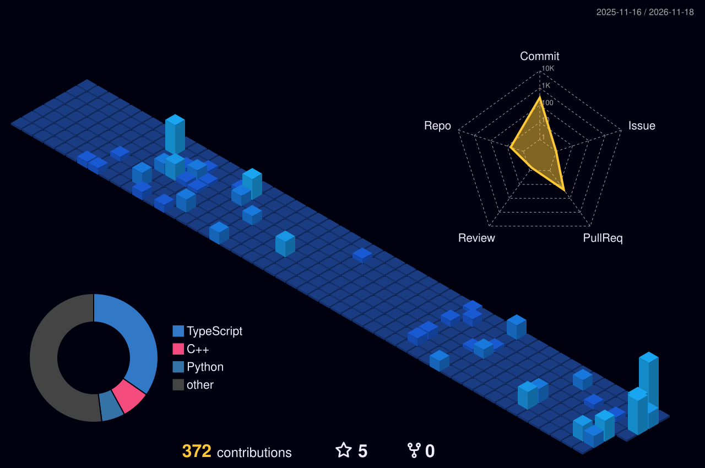

<picture>
  <source media="(prefers-color-scheme: dark)" srcset="./assets/branding/fieldnotes-header-dark.svg" />
  
</picture>

  <picture>
    <source media="(prefers-color-scheme: dark)" srcset="https://readme-typing-svg.demolab.com?font=JetBrains+Mono&size=17&pause=1100&color=FFFFFF&center=true&vCenter=true&width=760&lines=Information+Technology+Student;Exploring+software+and+systems;Learning+by+building+and+refining" />
    
  </picture>

## About

I'm **Om Joshi**, an Information Technology student at **NMIET, Pune**. I like understanding how systems work and turning ideas into practical experiments. I learn by studying the problem, building in small steps, testing the result, and documenting what I discover.

**Interests:** software development · computer systems · applied AI · blockchain · embedded systems

---

## Toolkit

  

Current working toolkit — a snapshot of foundations I'm actively developing.

---

## Selected work

### 01 / SureD
**Blockchain-based rental security deposit platform**

Explores a more transparent rental deposit lifecycle using the **Stellar network and Soroban smart contracts**: creation, funding, confirmation, and release or refund.

**In exploration:** SureD 2.0 planning considers co-tenants, shared contributions, and individual tracking. These are planned improvements, not shipped features.

[Live platform](https://sure-d.vercel.app/) · [Source repository](https://github.com/Khushal-93/SureD)

### 02 / DepthWizard
**Single-view height estimation and 3D flythrough**

A team project concept for **Smart India Hackathon 2026, SIH26175 / PS26175**. Proposed pipeline: RGB image → AI depth estimation → depth map → digital surface model → 3D flythrough.

Non-georeferenced images produce relative estimates; georeferenced inputs can support metric DSM outputs.

### 03 / CivicLoop
**Complaints That Don't Disappear**

A civic-technology concept selected for **Anveshana 2026–27 (Pune Region)**.

**Stage:** concept and planning; development has not started. Reporting, duplicate clustering, public timelines, and ward insights remain proposed features.

### 04 / WALL-E
**Autonomous obstacle-avoiding robot**

An Arduino-based robotics project using **C++, ultrasonic distance sensing, and motor control** to detect obstacles and respond through autonomous movement.

---

## GitHub activity

  <picture>
    <source media="(prefers-color-scheme: dark)" srcset="https://github-stats-extended.vercel.app/api?username=omjoshi-2307&show_icons=true&hide_border=true&include_all_commits=true&rank_icon=github&theme=github_dark" />
    
  </picture>

  <picture>
    <source media="(prefers-color-scheme: dark)" srcset="https://github-readme-activity-graph.vercel.app/graph?username=omjoshi-2307&bg_color=0A0A0A&color=FFFFFF&line=A3A3A3&point=FFFFFF&area=true&hide_border=true" />
    
  </picture>

### 3D contribution landscape

  

[View GitHub achievements ↗](https://github.com/omjoshi-2307)

---

OM JOSHI · INFORMATION TECHNOLOGY · PUNE, INDIA

  <a href="https://github.com/omjoshi-2307">GITHUB</a> &nbsp; / &nbsp;
  <a href="https://www.linkedin.com/in/0m-joshi2307">LINKEDIN</a> &nbsp; / &nbsp;
  <a href="https://x.com/omjoshi_2307">X</a> &nbsp; / &nbsp;
  <a href="mailto:omjoshi2307@gmail.com">EMAIL</a>
   
  

