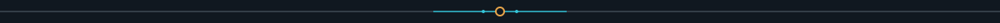

<picture>
  <source media="(prefers-color-scheme: dark)" srcset="./assets/branding/fieldnotes-header-dark.svg" />
  
</picture>

  <a href="#about">ABOUT</a> &nbsp; / &nbsp;
  <a href="#toolkit">TOOLKIT</a> &nbsp; / &nbsp;
  <a href="#selected-work">SELECTED WORK</a> &nbsp; / &nbsp;
  <a href="#activity">ACTIVITY</a> &nbsp; / &nbsp;
  <a href="#connect">CONNECT</a>

<strong>INFORMATION TECHNOLOGY STUDENT · NMIET, PUNE</strong>

## About

I'm **Om Joshi**, an Information Technology student who enjoys understanding how systems work and turning ideas into practical experiments. I learn by exploring, building, testing, documenting, and improving alongside other people.

- Interested in software development, computer systems, and applied engineering.
- Learning through coursework, independent builds, and collaborative projects.
- Focused on strong fundamentals and useful, well-documented work.

## Toolkit

  
  
  
  
  
  
  
  

Current working toolkit — a snapshot of foundations I'm actively developing.

## Selected Work

<table>
<tr>
<td width="50%" valign="top">

### 01 / SureD
**Blockchain-backed rental deposit escrow**

Explores transparent rental deposit creation, funding, confirmation, and release or refund using the **Stellar network and Soroban smart contracts**.

**Next exploration:** SureD 2.0 planning includes co-tenants, shared contributions, and individual tracking. These are planned, not shipped.

[Live platform](https://sure-d.vercel.app/) · [Source repository](https://github.com/Khushal-93/SureD)

</td>
<td width="50%" valign="top">

### 02 / DepthWizard
**Single-view height estimation and 3D flythrough**

A team project concept for **Smart India Hackathon 2026, SIH26175 / PS26175**. Proposed pipeline: RGB image → AI depth → depth map → digital surface model → 3D view.

Non-georeferenced images produce relative estimates; georeferenced inputs can support metric DSM outputs.

</td>
</tr>
<tr>
<td width="50%" valign="top">

### 03 / CivicLoop
**Complaints That Don't Disappear**

A civic-technology concept selected for **Anveshana 2026–27 (Pune Region)**.

**Stage:** concept and planning; development has not started. Reporting, duplicate clustering, public timelines, and ward insights remain proposed features.

</td>
<td width="50%" valign="top">

### 04 / WALL-E
**Autonomous obstacle-avoiding robot**

An Arduino-based robotics project using **C++, ultrasonic distance sensing, and motor control** to detect obstacles and respond through autonomous movement.

</td>
</tr>
</table>

## Activity

I use GitHub as a working notebook: documenting experiments, improving projects, collaborating, and learning in public.

  
  

  

### Contribution map

  <picture>
    <source media="(prefers-color-scheme: dark)" srcset="https://raw.githubusercontent.com/omjoshi-2307/omjoshi-2307/output/github-contribution-grid-snake-dark.svg" />
    
  </picture>

  
<strong>Field notes / How I work</strong>

  - Start by understanding the problem and its constraints.
  - Explore references and test small ideas before committing to a direction.
  - Build in manageable steps and keep changes reviewable.
  - Document decisions, verify outcomes, and refine based on evidence.

## Connect

  <a href="https://github.com/omjoshi-2307">GitHub</a> &nbsp;·&nbsp;
  <a href="https://www.linkedin.com/in/0m-joshi2307">LinkedIn</a> &nbsp;·&nbsp;
  <a href="https://x.com/omjoshi_2307">X</a> &nbsp;·&nbsp;
  <a href="mailto:omjoshi2307@gmail.com">Email</a>

FIELDNOTES IN COMPUTING · OM JOSHI · PUNE, INDIA

