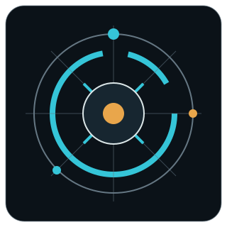
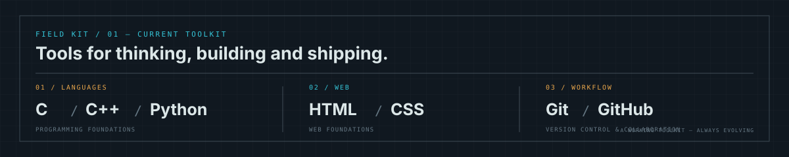
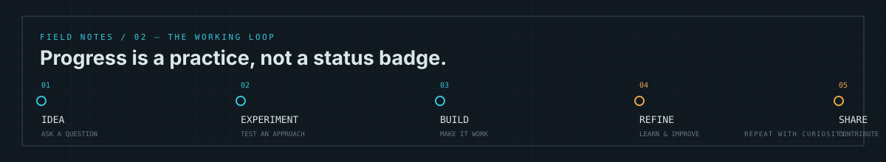
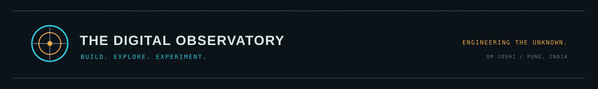

  

  

  <strong>INFORMATION TECHNOLOGY STUDENT</strong>
   
  BUILD. EXPLORE. EXPERIMENT.

  <a href="https://github.com/omjoshi-2307">GITHUB</a>
  &nbsp; / &nbsp;
  <a href="https://www.linkedin.com/in/0m-joshi2307">LINKEDIN</a>
  &nbsp; / &nbsp;
  <a href="https://x.com/omjoshi_2307">X</a>
  &nbsp; / &nbsp;
  <a href="mailto:omjoshi2307@gmail.com">EMAIL</a>

  

## 01 / Observatory Log

I'm an Information Technology student at **NMIET, Pune, India**. I enjoy exploring how software works, turning ideas into practical projects, and learning through experimentation.

My approach is simple: understand the problem, build a thoughtful solution, test it, and keep improving.

- Interested in software development, computer systems, and problem-solving.
- Learning through coursework, independent exploration, and collaborative projects.
- Open to connecting with fellow learners, developers, and builders.

  

## 02 / Technology Field Kit

  

**Programming:** C, C++, Python  
**Web foundations:** HTML, CSS  
**Developer tools:** Git, GitHub, VS Code

This is a working toolkit, not a fixed list. I'm continuously developing these foundations through practice and project work.

  

## 03 / Featured Expeditions

### 01 — SureD
**Blockchain-based rental security deposit platform**

  

SureD explores a more transparent rental deposit process using the **Stellar network and Soroban smart contracts**. Its core lifecycle covers deposit creation, funding, confirmation, and release or refund.

**Exploring next:** SureD 2.0 planning considers co-tenants, shared contributions, and individual deposit tracking. These are planned improvements, not shipped features.

[Live platform](https://sure-d.vercel.app/) · [Source repository](https://github.com/Khushal-93/SureD)

### 02 — DepthWizard
**Single-view height estimation and 3D flythrough**

  

A team project concept prepared for **Smart India Hackathon 2026, problem statement SIH26175 / PS26175**. The proposed web application explores estimating scene height from a single image and generating a 3D flythrough.

**Pipeline:** RGB image → AI depth estimation → depth map → digital surface model (DSM) → 3D view.

Non-georeferenced images produce relative depth and height estimates; georeferenced inputs can support absolute metric DSM outputs.

### 03 — CivicLoop
**Complaints That Don't Disappear**

  

A civic-technology concept selected for **Anveshana 2026–27 (Pune Region)**. Its goal is to make public complaints easier to follow through transparent status histories and evidence-based updates.

**Current stage:** concept and planning. Development has not started. Citizen reporting, duplicate clustering, public timelines, and ward-level insights remain proposed features.

### 04 — WALL-E
**Autonomous obstacle-avoiding robot**

  

An Arduino-based robotics project using **C++, ultrasonic distance sensing, and motor control** to detect obstacles and respond through autonomous movement.

  

## 04 / The Working Loop

  

I use GitHub to document learning, develop projects, collaborate, and improve through consistent practice.

  

  

## 05 / Connect

I'm glad to connect with people who enjoy learning, building, and exchanging ideas.

  <a href="https://github.com/omjoshi-2307">GitHub</a>
  &nbsp; · &nbsp;
  <a href="https://www.linkedin.com/in/0m-joshi2307">LinkedIn</a>
  &nbsp; · &nbsp;
  <a href="https://x.com/omjoshi_2307">X</a>
  &nbsp; · &nbsp;
  <a href="https://www.instagram.com/0m.a.joshi/">Instagram</a>
  &nbsp; · &nbsp;
  <a href="https://www.credly.com/users/om-joshi2623">Credly</a>
  &nbsp; · &nbsp;
  <a href="mailto:omjoshi2307@gmail.com">Email</a>

  

