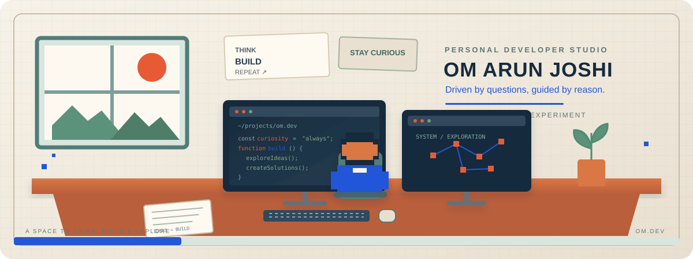
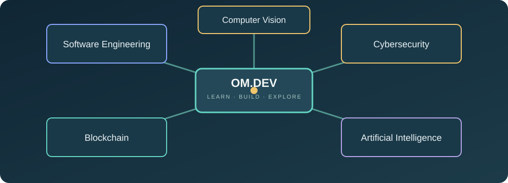
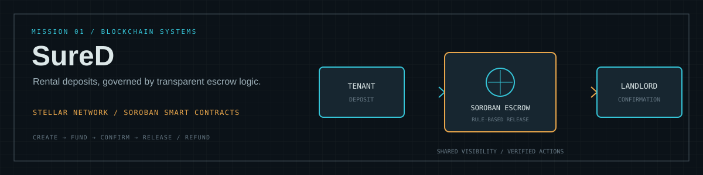
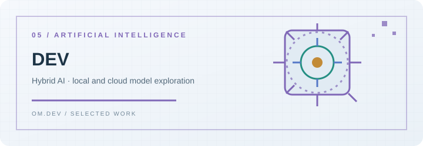
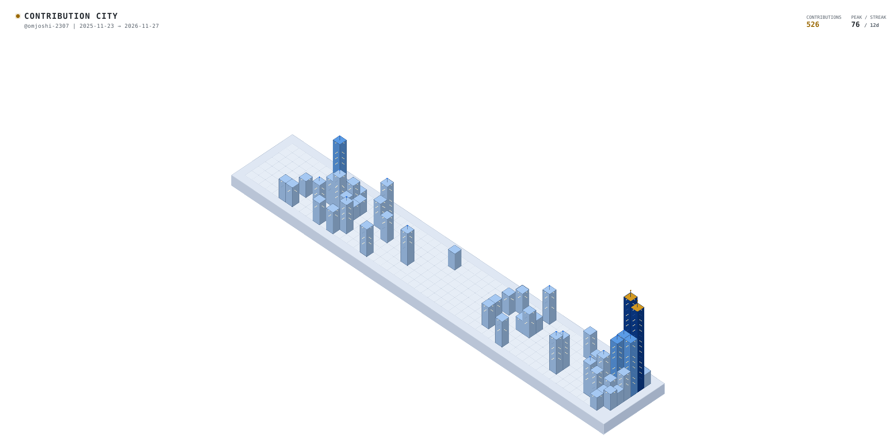

<!--
  OM.DEV — Bright Edition
  GitHub Profile README
-->

  

<h1 align="center">Om Arun Joshi</h1>

  <strong>Information Technology Student · Developer · Curious Builder</strong> 
  <em>Driven by questions, guided by reason.</em>

  
  
  
  
  
  

  📍 Pune, India &nbsp;·&nbsp; ✉️ <a href="mailto:omjoshi2307@gmail.com">omjoshi2307@gmail.com</a>

  

---

## 01 / A little about me

I'm an Information Technology student who enjoys understanding how systems work and turning ideas into practical software. I like exploring unfamiliar concepts, experimenting with different technologies, and learning by building.

My interests span software engineering, cybersecurity, blockchain, artificial intelligence, and computer vision. I value thoughtful problem-solving, clear architecture, and continuous improvement.

  

## 02 / Technologies & tools

**Languages and web**

  

**Frameworks, platforms and developer tools**

  

  
  
  
  
  

These icons represent technologies I've used or explored; they do not imply equal proficiency in every tool.

---

## 03 / Selected work

A selection of projects and concepts across different areas of technology. Their descriptions reflect their current stage.

<table>
  <tr>
    <td width="50%" valign="top">
      
      <h3>01. <a href="https://github.com/Khushal-93/SureD">SureD</a></h3>
      
<b>Blockchain · Rental security deposits</b>

      
A blockchain-based rental security deposit platform focused on transparent escrow, deposit handling, and multi-party coordination.

      <a href="https://sure-d.vercel.app/">↗ Live application</a>
    </td>
    <td width="50%" valign="top">
      
      <h3>02. <a href="https://github.com/omjoshi-2307/GSoC-Org-Finder-">GSoC Org Finder</a></h3>
      
<b>Developer tools · API integration</b>

      
A platform for discovering, filtering, and comparing Google Summer of Code organizations, with organization details and GitHub issue discovery.

      <a href="https://findmygsoc.vercel.app/">↗ Open the platform</a>
    </td>
  </tr>
  <tr>
    <td width="50%" valign="top">
      
      <h3>03. <a href="https://github.com/omjoshi-2307/CivicLoop">CivicLoop</a></h3>
      
<b>Civic technology · Anveshana 2026–27</b>

      
<i>Complaints That Don't Disappear.</i> A selected project proposal for a civic grievance platform centred on transparent complaint tracking and accountable resolution. Development has not started.

    </td>
    <td width="50%" valign="top">
      
      <h3>04. <a href="https://github.com/omjoshi-2307/jal-sanchaee-navachar-v2">Jal-Sanchaee-Navachar</a></h3>
      
<b>Smart irrigation · Water management</b>

      
A water-conservation project exploring irrigation planning and community water credits through rule-based decisions and weather-informed inputs. Multiple repositories represent iterations of the same project.

    </td>
  </tr>
  <tr>
    <td width="50%" valign="top">
      
      <h3>05. <a href="https://github.com/omjoshi-2307/Dev">DEV</a></h3>
      
<b>Hybrid AI · Model architecture</b>

      
An early-stage exploration of a personal AI assistant architecture, including local and cloud model integration, model routing, and privacy-aware execution.

    </td>
    <td width="50%" valign="top">
      
      <h3>06. DepthWizard</h3>
      
<b>Computer vision · SIH26175 concept</b>

      
A proposed single-view height-estimation and 3D flythrough pipeline, moving from an RGB image to depth estimation, a depth map, a digital surface model, and a 3D visualization.

    </td>
  </tr>
</table>

---

## 04 / What I'm learning

  

Currently focused on strengthening programming and computer science fundamentals, exploring cybersecurity and secure software design, learning more about AI systems, and improving project architecture and developer workflows.

## 05 / GitHub activity

  

  
  

  

  

---

## 06 / Contact

I'm open to thoughtful conversations, collaboration, and learning from other builders.

| Channel | Details |
|:--|:--|
| Email | [omjoshi2307@gmail.com](mailto:omjoshi2307@gmail.com) |
| Portfolio | [portfolio2307.vercel.app](https://portfolio2307.vercel.app/) |
| GitHub | [@omjoshi-2307](https://github.com/omjoshi-2307) |
| LinkedIn | [linkedin.com/in/0m-joshi2307](https://www.linkedin.com/in/0m-joshi2307/) |
| X | [@omjoshi_2307](https://x.com/omjoshi_2307) |
| Instagram | [@0m.a.joshi](https://www.instagram.com/0m.a.joshi/) |
| Location | Pune, India |

  <strong>Thanks for visiting my workspace.</strong> 
  Learn continuously. Build purposefully. Improve consistently.

