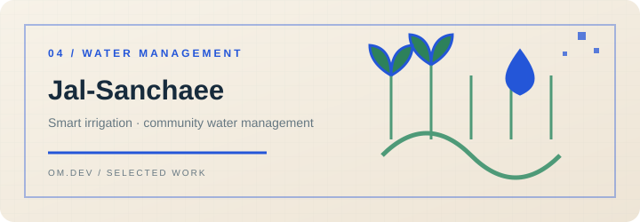
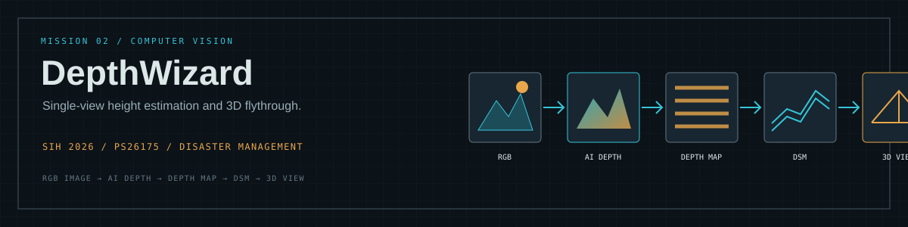

<!--
  OM.DEV — Pixel Developer Studio
  Profile README | V2 — Visual Studio Edition
-->

  

  <strong>B.Tech Information Technology Student</strong> 
  <em>Driven by questions, guided by reason.</em> 
  CODE&nbsp; · &nbsp;EXPLORE&nbsp; · &nbsp;EXPERIMENT

  
  
  

  

---

## 01 / Beyond the code

I'm an Information Technology student who enjoys understanding how systems work and turning ideas into practical software. I like exploring unfamiliar concepts, experimenting with different technologies, and learning by building.

My interests span software engineering, cybersecurity, blockchain, artificial intelligence, and computer vision. I value thoughtful problem-solving, clear architecture, and continuous improvement.

  

## 02 / Tools in my workspace

**Languages & web**

  

**Frameworks, platforms & developer tools**

  

  
  
  
  
  

Icons represent technologies I've used or explored across my work; they do not imply equal proficiency in every tool.

---

## 03 / Selected work

A visual tour of six projects and concepts across different areas of technology.

<table>
  <tr>
    <td width="50%" valign="top">
      
      <h3>01. <a href="https://github.com/Khushal-93/SureD">SureD</a></h3>
      
<b>Blockchain · Rental security deposits</b>

      
A blockchain-based rental security deposit platform focused on transparent escrow, deposit handling, and multi-party coordination.

      <a href="https://sure-d.vercel.app/">↗ Live application</a>
    </td>
    <td width="50%" valign="top">
      
      <h3>02. <a href="https://github.com/omjoshi-2307/GSoC-Org-Finder-">GSoC Org Finder</a></h3>
      
<b>Software engineering · API integration</b>

      
A developer-focused platform for discovering, filtering, and comparing Google Summer of Code organizations, with organization details and GitHub issue discovery.

      <a href="https://findmygsoc.vercel.app/">↗ Open the platform</a>
    </td>
  </tr>
  <tr>
    <td width="50%" valign="top">
      
      <h3>03. <a href="https://github.com/omjoshi-2307/CivicLoop">CivicLoop</a></h3>
      
<b>Civic technology · System architecture</b>

      
<i>Complaints That Don't Disappear.</i> A civic grievance platform being developed around transparent complaint tracking, public status updates, and accountable resolution workflows.

    </td>
    <td width="50%" valign="top">
      
      <h3>04. <a href="https://github.com/omjoshi-2307/jal-sanchaee-navachar-v2">Jal-Sanchaee-Navachar</a></h3>
      
<b>Smart irrigation · Water management</b>

      
A water-conservation project exploring irrigation planning and community water credits through rule-based decisions and weather-informed inputs. Multiple repositories represent iterations of this same project.

    </td>
  </tr>
  <tr>
    <td width="50%" valign="top">
      
      <h3>05. <a href="https://github.com/omjoshi-2307/Dev">DEV</a></h3>
      
<b>Hybrid AI · Model architecture</b>

      
An ongoing exploration of a personal AI assistant architecture, including local and cloud model integration, model routing, and privacy-aware execution.

    </td>
    <td width="50%" valign="top">
      
      <h3>06. DepthWizard</h3>
      
<b>Computer vision · 3D visualization concept</b>

      
A single-view height-estimation and 3D flythrough concept. Its proposed pipeline moves from an RGB image to depth estimation, a depth map, a digital surface model, and a 3D visualization.

    </td>
  </tr>
</table>

---

## 04 / Current chapter

  

Currently focused on strengthening programming and computer science fundamentals, exploring cybersecurity and secure software design, learning more about AI systems, and improving project architecture and developer workflows.

## 05 / GitHub activity

  <picture>
    <source media="(prefers-color-scheme: dark)" srcset="https://raw.githubusercontent.com/omjoshi-2307/omjoshi-2307/output/github-contribution-grid-snake-dark.svg" />
    <source media="(prefers-color-scheme: light)" srcset="https://raw.githubusercontent.com/omjoshi-2307/omjoshi-2307/output/github-contribution-grid-snake.svg" />
    
  </picture>

  
  

  

  

---

  

  <strong>Thanks for visiting my workspace.</strong> 
  Learn continuously. Build purposefully. Improve consistently.  
  <a href="https://github.com/omjoshi-2307">EXPLORE MY REPOSITORIES ↗</a>

